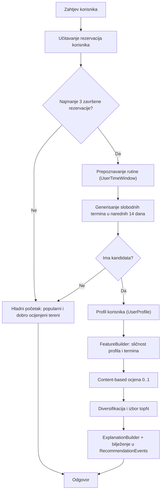

# Dokumentacija sistema za preporuke

## 1. Uvod

TerminBA sistem za preporuke korisnicima predlaže **sportske centre, objekte (terene), lokacije i vremenske termine** koji su trenutno slobodni i koji odgovaraju njihovim navikama. Cilj je povećati angažman korisnika i broj rezervacija tako što se korisniku prikazuju termini koje bi on najvjerovatnije i sam izabrao.

Sistem koristi pristup **Content-Based Filtering**: na osnovu historije rezervacija i recenzija formira se profil korisnika, koji se zatim upoređuje s karakteristikama svakog slobodnog termina. Sistem ne koristi istrenirani ML model, pa nema faze treniranja, pozadinskog servisa za treniranje – preporuke se računaju u trenutku zahtjeva nad aktuelnim podacima iz baze.

## 2. Korištene tehnologije

- **C# / .NET 8**
- **Entity Framework Core** za pristup podacima i izvršavanje upita.
- **Newtonsoft.Json** za serijalizaciju objašnjenja preporuka koja se bilježe u tabelu `RecommendationEvents`.

## 3. Arhitektura sistema

| Komponenta | Uloga |
|---|---|
| `RecommendationsController` | `GET api/recommendations?topN=5` (uloga `User`), vraća listu `RecommendationResult`. |
| `RecommendationService` | Gradi profil i rutinu korisnika, generiše slobodne termine, računa ocjenu, bira i bilježi preporuke. |
| `FeatureBuilder` | Upoređuje profil korisnika s karakteristikama termina i vraća normalizovane karakteristike sličnosti (`CandidateFeatures`). |
| `ExplanationBuilder` | Generiše razloge preporuke razumljive korisniku. |
| `UserProfile`, `UserTimeWindow`, `TimeSlotCandidate`, `CandidateFeatures` | Modeli profila, rutine, kandidata i karakteristika. |

Tok obrade jednog zahtjeva:



## 4. Izvori podataka

| Tabela | Upotreba |
|---|---|
| `Reservations` | Historija korisnika (profil i rutina), zauzetost terena i zauzetost samog korisnika, popularnost terena. |
| `FacilityReviews` | Ocjene korisnika (težina rezervacija, kazna za loše ocijenjene terene) i prosječne ocjene svih korisnika. |
| `Facilities` | Sportovi, zatvoreno/otvoreno, tip podloge, trajanje termina, cijene. |
| `SportCenters`, `WorkingHours` | Sportski centar, grad (lokacija) i radno vrijeme. |
| `FacilityDynamicPrices` | Dinamičke cijene termina. |
| `Users` | Grad korisnika (slab signal lokacije i kriterij za hladni početak). |

Rezervacije sa statusima `CanceledReservationState`, `CanceledWithRefundReservationState` i `CanceledWithoutRefundReservationState` se ne uzimaju u obzir.

## 5. Prepoznavanje rutine korisnika (`UserTimeWindow`)

Rutina se izvodi iz **završenih** rezervacija (`CompletedReservationState`). Ako korisnik ima manje od 3 završene rezervacije, koristi se logika hladnog početka.

- **Učestalost po danima (`DayFrequency`)** – broj igranja po danu u sedmici, ponderisan svježinom rezervacije i normalizovan na najčešći dan (najčešći dan = 1).
- **Preferirani dani (`PreferredDays`)** – dva najčešća dana.
- **Uobičajeno vrijeme (`MedianStart`)** – medijan vremena početka termina.
- **Rutinski termini (`RoutineSlots`)** – kombinacije *(dan u sedmici, vrijeme početka zaokruženo na 30 min)* koje su se ponovile najmanje 2 puta, npr. „utorak oko 19:00”.

Udaljenost termina od uobičajenog vremena računa se kao manja od udaljenosti do medijana i udaljenosti do rutinskih termina tog dana. Tako se ispravno prepoznaju korisnici koji, npr., radnim danima igraju navečer, a vikendom ujutro.

## 6. Profil korisnika (`UserProfile`)

Profil se gradi iz svih neotkazanih rezervacija korisnika (uključujući buduće, jer i one pokazuju preferencije). Svaka rezervacija dobija težinu:

```
težina = svježina × ocjena
svježina = max(0.25, 0.5 ^ (starost u danima / 120))   // buduće rezervacije = 1
ocjena   = ocjena korisnika / 3                         // 5 → 1.67, 3 → 1.0, 1 → 0.33, bez recenzije → 1.0
```

Ocjena se uzima iz recenzije vezane za tu rezervaciju, a ako je nema, iz prosječne ocjene koju je korisnik dao tom terenu.

Na osnovu ponderisanih rezervacija i recenzija formiraju se:

| Atribut profila | Opis |
|---|---|
| `SportPreference` | Udio svakog sporta (izabrani sport rezervacije; ako nije izabran, težina se dijeli na sve sportove terena). Zbir = 1. |
| `MostBookedSportId` | Sport s najvećom težinom. |
| `SportCenterAffinity` | Naklonost prema sportskim centrima, normalizovana na omiljeni centar. |
| `CityPreference` | Gradovi u kojima korisnik igra, normalizovano na najčešći grad. |
| `TurfTypePreference` | Tipovi podloge, normalizovano na najčešći tip. |
| `IndoorPreference` | Udio zatvorenih terena (0 = uvijek otvoreni, 1 = uvijek zatvoreni). |
| `AveragePaidPrice` | Prosječna plaćena cijena. |
| `BookingCountPerFacility`, `BookedSportCenterIds` | Ranije rezervisani tereni i centri. |
| `UserRatingPerFacility` | Prosječna ocjena korisnika po terenu. |
| `OverallRatingPerFacility`, `ReviewCountPerFacility`, `GlobalAverageRating` | Ocjene svih korisnika i globalni prosjek. |

## 7. Generisanje kandidata i provjera dostupnosti

`GetAvailableSlotsAsync` generiše termine za svaki teren u narednih **14 dana** (od sutra), u koracima trajanja termina (`Facility.Duration`), unutar radnog vremena sportskog centra. Termin postaje kandidat samo ako:

1. postoji važeće radno vrijeme za taj dan (`StartDay`–`EndDay`, `ValidFrom` ≤ datum ≤ `ValidTo`),
2. teren **nema aktivnu rezervaciju** koja se preklapa s terminom,
3. **korisnik nema drugu aktivnu rezervaciju** u isto vrijeme,
4. (za personalizovane preporuke) dan je jedan od dana na koje korisnik igra, a početak je najviše **120 minuta** udaljen od uobičajenog vremena.

Cijena kandidata računa se prema cjenovniku terena (statička ili dinamička cijena za dan i vrijeme).

## 8. Algoritam preporuka (Content-Based Filtering)

`FeatureBuilder` za svaki kandidat računa karakteristike sličnosti u opsegu `0..1`, a `RecommendationService.CalculateContentBasedScore` ih kombinuje ponderisanim zbirom:

| Karakteristika | Težina | Značenje |
|---|---|---|
| `SportMatchScore` | 22% | Zbir udjela korisnikovih sportova koje teren nudi. |
| `TimeWindowFitScore` | 17% | `1 − razlika u minutama / 120` u odnosu na uobičajeno vrijeme. |
| `SportCenterAffinity` | 13% | Naklonost korisnika prema sportskom centru kandidata. |
| `DayOfWeekFitScore` | 10% | Koliko često korisnik igra tog dana u sedmici. |
| `FacilityQualityScore` | 10% | Bayesovski izglađena ocjena svih korisnika / 5: `(prosjek × broj + globalni prosjek × 3) / (broj + 3)`. |
| `LocationMatchScore` | 8% | Preferencija grada kandidata; najmanje 0.6 ako je teren u gradu korisnika. |
| `PriceFitScore` | 8% | `1 − |cijena − prosječna cijena| / prosječna cijena` (0.5 ako nema podataka o cijeni). |
| `FacilityAttributeMatchScore` | 7% | Prosjek sličnosti zatvoreno/otvoreno i preferencije tipa podloge. |
| `RoutineMatch` | 5% | 1 ako termin odgovara rutinskom terminu (isti dan, ±30 min). |

```csharp
float score =
    WeightSport * f.SportMatchScore +
    WeightTimeOfDay * f.TimeWindowFitScore +
    WeightSportCenter * f.SportCenterAffinity +
    WeightDayOfWeek * f.DayOfWeekFitScore +
    WeightQuality * f.FacilityQualityScore +
    WeightLocation * f.LocationMatchScore +
    WeightPrice * f.PriceFitScore +
    WeightFacilityAttributes * f.FacilityAttributeMatchScore +
    WeightRoutine * f.RoutineMatch;

if (f.FacilityAvgUserRating > 0f && f.FacilityAvgUserRating <= 2f)
    score *= DislikedFacilityPenalty; // 0.5

return Math.Clamp(score, 0f, 1f);
```

Ako je korisnik teren ocijenio ocjenom 2 ili nižom, ocjena kandidata se prepolovljuje, tako da se loše ocijenjeni tereni ne preporučuju samo zato što odgovaraju rutini.

## 9. Izbor preporuka

1. Kandidati se sortiraju opadajuće po ocjeni (pri jednakoj ocjeni ranije vrijeme ima prednost).
2. **Diversifikacija:** najprije se uzima najbolji termin za svaki teren, kako preporuke ne bi bile više termina istog terena.
3. Ako nakon toga ima manje od `topN` preporuka, preostala mjesta se popunjavaju sljedećim najbolje ocijenjenim terminima.
4. Za odabrane termine generišu se objašnjenja, a preporuke se bilježe u tabelu `RecommendationEvents` (ocjena, termin, objašnjenja, `ShownAt`).

`topN` je ograničen na 1–20 (podrazumijevano 5). Polje `Score` u odgovoru je content-based ocjena u opsegu `0..1`, a `IsPersonalized = true`.

## 10. Objašnjenja preporuka (`ExplanationBuilder`)

Razlozi se dodaju redom važnosti i prikazuju se najviše 4:

| Uslov | Razlog |
|---|---|
| `RoutineMatch = 1` | „The court is free at your regular {dan} time ({HH:mm}).” |
| inače `TimeWindowFitScore ≥ 0.8` | „The court is free at your favorite playing time.” |
| inače | „The slot is available during your usual playing time.” |
| Teren ranije rezervisan | „You previously booked a court at {teren}.” |
| inače centar ranije posjećen | „You have played at {sportski centar} before.” |
| Korisnikova ocjena ≥ 4 | „You rated this court highly.” |
| Teren nudi najčešći sport | „Matches the sport you play most often.” |
| `DayOfWeekFitScore ≥ 0.8` (bez rutine) | „You often play on {dan}s.” |
| `LocationMatchScore ≥ 0.8` (novi centar) | „Located in the area where you usually play.” |
| `FacilityAttributeMatchScore ≥ 0.8` | „Same type of court you usually book (indoor/outdoor).” |
| `PriceFitScore ≥ 0.8` | „The price is in line with what you usually pay.” |
| Ocjena ostalih korisnika ≥ 4 | „Other users rate this center highly.” |
| Nijedan dodatni razlog | „Recommended based on similarity with your previous bookings.” |

## 11. Hladni početak (*cold start*)

Koristi se kada korisnik ima manje od 3 završene rezervacije ili kada nijedan slobodan termin ne odgovara njegovoj rutini. Tada se preporuke **ne personalizuju** (`IsPersonalized = false`), a tereni se rangiraju po:

```
ocjena = 0.60 × (izglađena ocjena / 5) + 0.25 × popularnost + 0.15 × (teren u gradu korisnika ? 1 : 0)
```

- *izglađena ocjena* – ista Bayesovska formula kao u poglavlju 8,
- *popularnost* – broj neotkazanih rezervacija terena u posljednjih 90 dana, normalizovan na najpopularniji teren.

Za najbolje rangirane terene (do `3 × topN`) traži se **najraniji stvarno slobodan termin** u narednih 14 dana, uz iste provjere dostupnosti kao u poglavlju 7. Vraća se prvih `topN` terena koji imaju slobodan termin. Objašnjenja uključuju: popularan teren (u vašem gradu), visoku ocjenu ostalih korisnika, čestu rezervisanost i informaciju da je to sljedeći slobodan termin.

## 12. Zaključak

Sistem za preporuke kombinuje profil korisnika izveden iz historije rezervacija i recenzija s karakteristikama sportskih centara, terena, lokacija i termina. Prepoznavanjem rutina (dana, vremena i ponavljajućih termina) i provjerom stvarne dostupnosti terena i korisnika, korisniku se preporučuju samo termini koje zaista može rezervisati i koji odgovaraju njegovim navikama. Ponderisani content-based model je transparentan, ne zahtijeva treniranje i odmah reaguje na nove rezervacije i recenzije, dok objašnjenja korisniku jasno pokazuju zašto mu je određeni termin preporučen.
